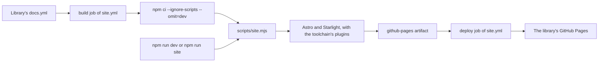

# Architecture

How NCode Docs is built. [assurance-case.md](assurance-case.md) explains why the design meets its security
requirements.

## Components

A library's `.github/workflows/docs.yml` calls `.github/workflows/site.yml` at a pinned commit of this repository. Its
build job checks out the library and the toolchain, installs the locked packages and runs `scripts/site.mjs`, which
copies the library's content folder into the toolchain and runs Astro. A maintainer runs the same script beside a clone
of a library, with `npm run dev` or `npm run site`.

| Component | Role |
| --- | --- |
| Reusable workflow (`.github/workflows/site.yml`) | Two jobs: `build` checks out the library and the toolchain at the pinned commit, installs, builds and uploads the site; `deploy` hands the artifact to GitHub Pages, from the library's default branch only |
| Site script (`scripts/site.mjs`) | Checks its arguments, resolves the library, reads the samples once, takes the checkout's lock, copies the content folder to `src/content/docs/` and runs `astro build --force`, `dev` or `preview` |
| Library settings (`src/library.mjs`, `src/json-schema.mjs`, `schema/site.config.schema.json`) | Reads `DOCS_LIBRARY` and `DOCS_CONTENT`, checks `site.config.json` against the schema, resolves the sample globs to files inside the library, and dates each page with one `git log` |
| Astro project (`astro.config.mjs`, `src/integration.mjs`, `src/content.config.ts`) | Configures Starlight from the library's settings: the base path from `SITE_URL` or `site.url`, the Markdown plugins, the link checks, and the import aliases `@ncodegroup/docs/components`, `@site/components/` and `@site/assets/` |
| Samples (`src/snippets/`) | Reads the regions of the sample files and fills each `snippet=Key` block ([ADR-1002](decisions/1002-a-page-includes-a-compiled-sample-by-its-key-when-the-site-is-built.md)) |
| Links (`src/links/`, `starlight-links-validator`) | Adds the base path to the links an author writes, fails the build on a broken link, and reads every built page for a link outside the base path ([ADR-1003](decisions/1003-links-are-written-from-the-site-root-and-the-build-proves-none-leaves-the-base-path.md)) |
| Route middleware (`src/route-data.ts`) | Adds the base path to frontmatter links, and sets each page's edit link and "last updated" date from the library's repository |
| Code blocks (`ec.config.mjs`, `src/highlighting/`) | Expressive Code's theme, from the brand tokens, and Shiki's C# grammar with two rules for C# 14 extension blocks ([ADR-1004](decisions/1004-the-csharp-grammar-is-patched-at-build-time-for-extension-blocks.md)) |
| Theme (`src/styles/theme.css`, `src/components/`, `vendor/instrument/`) | The vendored brand tokens, fonts and marks, the stylesheet that maps Starlight onto them, the shared components and three Starlight overrides |
| Vendor check (`scripts/check-vendor.mjs`) | Fails when a vendored file differs from the SHA-256 its `manifest.json` records |
| Fixture and tests (`fixture/`, `test/`, `scripts/screenshots.mjs`) | A stand-in library that `npm run build` builds, the `node:test` suites that build it and broken copies of it, and screenshots to check a theme change |

## Design Rules

- A library holds its content only. The toolchain, its packages and the workflow live here, and one pinned commit
  selects them together
  ([ADR-1001](decisions/1001-the-toolchain-lives-in-this-repository-and-a-library-calls-it-by-one-pinned-commit.md));
  [CONTRACT.md](../CONTRACT.md) is the interface between the two.
- The job that runs the packages and a library's pages holds no write permission, and the job that deploys runs no code
  of the library or the toolchain
  ([ADR-1001](decisions/1001-the-toolchain-lives-in-this-repository-and-a-library-calls-it-by-one-pinned-commit.md)).
- No job restores or saves a cache, and every build is a full build
  ([ADR-1001](decisions/1001-the-toolchain-lives-in-this-repository-and-a-library-calls-it-by-one-pinned-commit.md),
  [ADR-1002](decisions/1002-a-page-includes-a-compiled-sample-by-its-key-when-the-site-is-built.md)).
- A sample or a link the build cannot place fails the build, never a warning, and the message names the file as its
  author knows it
  ([ADR-1002](decisions/1002-a-page-includes-a-compiled-sample-by-its-key-when-the-site-is-built.md),
  [ADR-1003](decisions/1003-links-are-written-from-the-site-root-and-the-build-proves-none-leaves-the-base-path.md)).
- Sites use Starlight's core with one add-on, the link validator, and a package is added only for what every library's
  site needs
  ([ADR-1000](decisions/1000-library-sites-are-built-with-astro-starlight-core-only.md)). Biome is a devDependency,
  which the workflow's install leaves out
  ([ADR-1005](decisions/1005-biome-lints-astro-components-without-formatting-them.md)).
- The C# grammar patch steps aside when the grammar has a rule of its own for extension blocks, and stops the build
  when a rule it builds on is missing
  ([ADR-1004](decisions/1004-the-csharp-grammar-is-patched-at-build-time-for-extension-blocks.md)).
- The build writes nothing to the library: it reads a copy of the content folder, which git ignores and the next run
  replaces.
- Vendored files are never edited here, and `src/styles/theme.css` and `ec.config.mjs` state no colour of their own.
- Decisions the design rests on are recorded in [decisions/](decisions/README.md).

## Build and Release

CI runs the project's commands on every pull request (`.github/workflows/ci.yml`). `AGENTS.md`'s Landing section sets
`release: tag+release`, so `.github/workflows/tag-release.yml` runs CI again on a release's commit, then tags and
publishes the release as its pull request merges, as
[ADR-0016](decisions/project-template/0016-releases-are-tagged-and-published-when-their-pull-request-merges.md) records.
