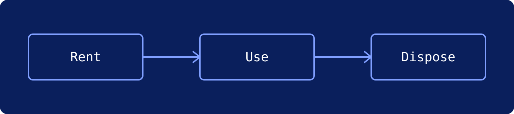

import { Status } from '@ncodegroup/docs/components';
import ByteGrid from '@site/components/ByteGrid.astro';
import MemoryMap from '@site/components/MemoryMap.astro';
import lifecycle from '@site/assets/lifecycle.svg';

A vault has three moments: it is rented, used, and disposed.

## Pinning

The buffer is allocated where the garbage collector never moves it, so no stale copy of it is left behind.

## Zeroing

`Dispose` overwrites every byte. Halfway through, the buffer looks like this:

<ByteGrid bytes="D0 17 6B F4 28 A9 4E 73" zeroed={4} label="Eight bytes, the first four zeroed" />

| Step | What happens | Sealed |
| --- | --- | --- |
| Rent | A pinned buffer leaves the pool | <Status state="success">Yes</Status> |
| Use | The caller writes the secret into it | <Status state="success">Yes</Status> |
| Dispose | Every byte is overwritten, then the buffer returns to the pool | <Status state="off">No</Status> |

## Layout in memory

A 64-byte vault is one row of 64 bytes, each numbered by its offset. After `Dispose` every one of them is zero:

<MemoryMap length={64} label="A 64-byte buffer after Dispose: every byte is zero" />

Back to the [quick start](/quick-start/).
